# KNULLD: what it is and how to read it

KNULLD looks at network traffic and says, for each connection, whether it is normal or an attack, and which kind of attack.
It does this with machine learning models trained on a public dataset of recorded attacks.
The web app lets you watch it work, look inside one decision, and see how good (and how fragile) the models are.

Run it: `python app.py`, then open http://localhost:8765. Setup steps are in the README.

---

## Words you will see

| Word | Meaning here |
|---|---|
| **Flow** | One conversation between two computers, e.g. your laptop loading one web page from a server. Everything is judged one flow at a time. |
| **Feature** | A number that describes a flow. We use 47 of them: how long it lasted, how many packets each side sent, packet sizes, gaps between packets, which TCP flags appeared. |
| **Benign** | Normal traffic. |
| **Attack family** | The kind of attack. We use 6: DoS, DDoS, PortScan, BruteForce, WebAttack, Bot (explained below). |
| **Model** | A program that learned from examples to map 47 numbers to one of 7 labels (benign + 6 families). |
| **Precision / recall / F1** | Recall = of the real attacks, how many we caught. Precision = of the things we flagged, how many were really attacks. F1 = one number combining both. |
| **Macro-F1** | F1 averaged over the 7 classes equally. A tiny class (22 web-attack flows) counts as much as 286k benign flows, so a model can't look good by only getting the big class right. |
| **False alarm rate** | Share of normal flows wrongly flagged as attacks. |
| **Confusion matrix** | Table of "truth vs what the model said". The diagonal is correct, everything else is a mistake. |
| **SHAP** | Shows which features pushed a model's decision and in which direction, for one flow. |
| **Autoencoder / novelty** | A small neural network trained only on normal traffic. It scores how "unlike normal" a flow is. Above 1 = unusual. |
| **Zero-day** | An attack type the model has never seen in training. |
| **Cross-dataset** | Testing on data from a different network than the one the model trained on. |
| **pcap** | A file of captured network packets (what Wireshark saves). |

## The 6 attack families

| Family | What it is | Typical flow looks like |
|---|---|---|
| **DoS** | One machine floods or ties up a web server (tools: Hulk, GoldenEye, Slowloris, Slowhttptest). | many requests, or very slow connections kept open |
| **DDoS** | Many machines flood a server at once (LOIC). | huge packet rates to port 80 |
| **PortScan** | Knocking on many ports to see what is open (nmap). | tiny flows: one SYN, one RST back |
| **BruteForce** | Guessing passwords on FTP / SSH over and over (Patator). | many short logins to port 21 / 22 |
| **WebAttack** | Web login guessing, XSS, SQL injection against a website. | normal-looking web requests with odd sizes |
| **Bot** | An infected PC phoning home to its controller (Ares botnet). | small, regular check-ins to the same server |

Heartbleed and Infiltration also exist in the data but have only 11 and 36 flows, too few to learn. We keep them out of training and use them as "never seen" attacks.

---

## How it works

```
captured packets ──► flows + 47 features ──► 6 classifiers + 1 autoencoder ──► verdict, reasons, novelty score
```

1. **Data.** CIC-IDS2017, a week of recorded traffic from a test network with real attacks run on it. We use the *corrected* version (Engelen et al.), because the original has known labelling mistakes. A second dataset, CSE-CIC-IDS2018 (different network, a year later), is used only for testing.
2. **Cleaning.** 2.10M flows → 1.71M after removing duplicates and contradictory rows. IP addresses, ports and timestamps are thrown away as inputs, so a model can't cheat by memorising "attacker IP = attack".
3. **Split by time.** For every day and attack type: first 60% of flows → training, next 20% → validation, last 20% → test. The test set is always *later* traffic than the training set, like real life.
4. **Models.** Six classifiers, from simple to strong: Perceptron, Linear regression, Logistic regression, SVM, MLP (neural network, PyTorch), LightGBM (boosted trees). Plus the autoencoder for novelty.
5. **App.** Loads the trained models and shows the results. Uploaded pcaps are turned into the same 47 features by our own code (`flows.py`), so the same models can judge them.

**So yes, it classifies attacks from parameters.** The parameters are the 47 flow features (packet counts, sizes, timing, flags). The models never look at packet contents or IPs.

---

## The screens

### 01 TAP: watch it classify

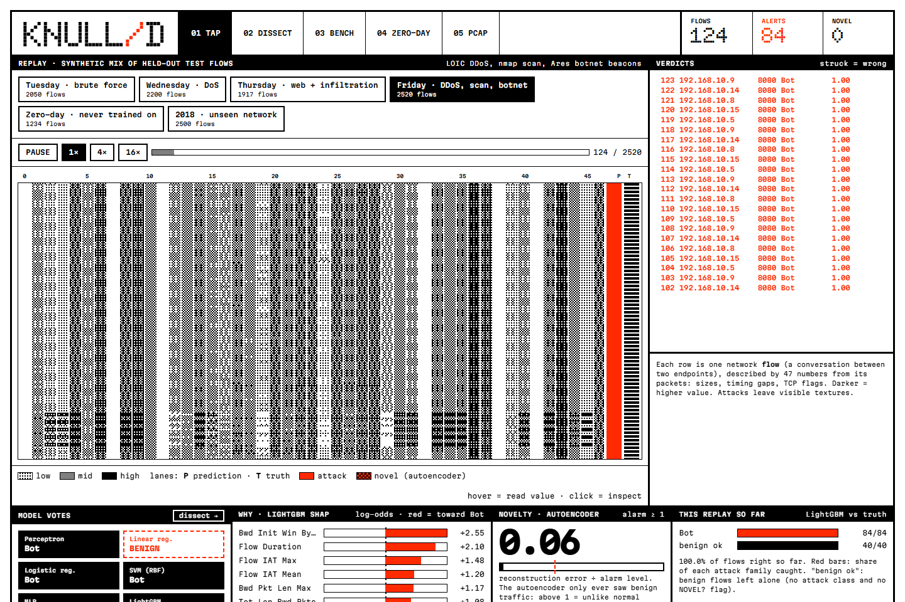

- Pick a scenario at the top (e.g. *Friday · DDoS, scan, botnet*). It replays real test flows the models never trained on, mixed together for the demo.
- **The bitmap**: each row is one flow, each column is one of the 47 features. Darker = bigger value. Attacks show up as repeating textures because attack flows look alike.
- **Lane P** = what LightGBM predicted (red = attack, red/black checks = "novel"). **Lane T** = the true label. If P and T disagree, the model was wrong.
- **Verdicts** (right): live log. Struck-through lines are mistakes.
- Hover the bitmap to read a value, click a row to inspect that flow below.

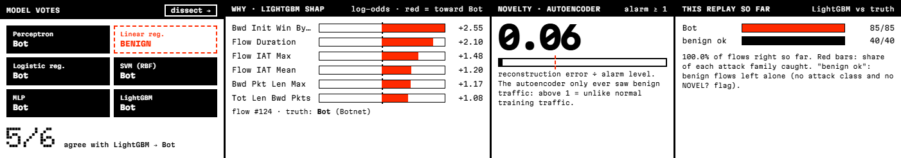

- **Model votes**: what all 6 models said for the selected flow. Black = agrees with LightGBM, red dashed = disagrees.
- **Why**: the features that pushed LightGBM's decision most (SHAP). Red bar = pushed toward the verdict.
- **Novelty**: the autoencoder's score. Above 1 = unlike normal traffic. If LightGBM says benign but this is above 1, the flow is marked **NOVEL?**.
- **This replay so far**: how many of each family were caught, and how many normal flows were left alone.

### 02 DISSECT: one flow up close

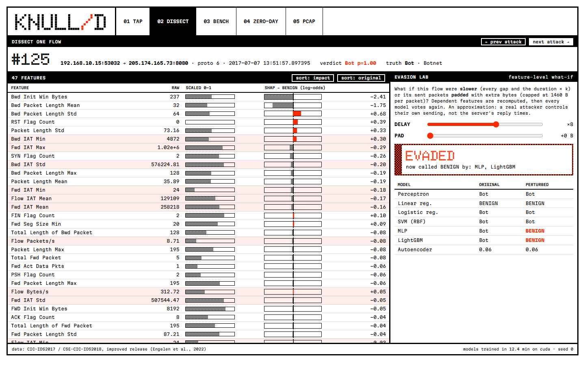

- Left: all 47 features of the flow, the raw value, the scaled value, and how much each one pushed the decision.
- Right, **Evasion lab**: a "what if". Slide **DELAY** to stretch the flow's timing, or **PAD** to add bytes to its packets, and all models vote again.
- In the example, a botnet flow stretched 8× in time fools LightGBM and the MLP, while the SVM and logistic regression still catch it.
- This is done on the features, not by replaying real packets. Treat it as a quick experiment, not proof of a real-world attack.

### 03 BENCH: the results

**Models and confusion matrix**

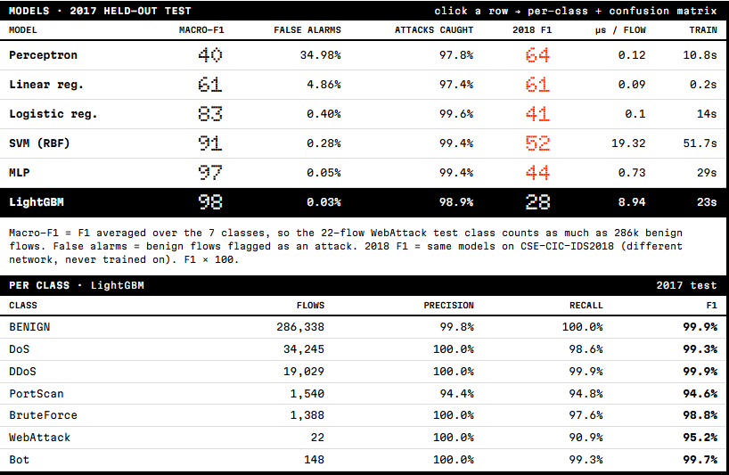
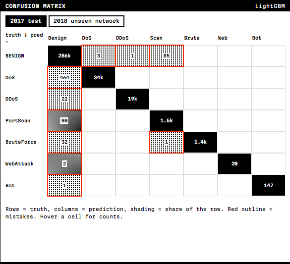

| Model | Macro-F1 | False alarms | Attacks caught |
|---|---|---|---|
| Perceptron | 40 | 35.0% | 97.8% |
| Linear regression | 61 | 4.9% | 97.4% |
| Logistic regression | 83 | 0.40% | 99.6% |
| SVM (RBF) | 91 | 0.28% | 99.4% |
| MLP | 97 | 0.05% | 99.4% |
| LightGBM | **98** | **0.03%** | 98.9% |

These are the shipped run (seed 0). Retrained with 5 seeds: Perceptron 66 (range 40–80), MLP 95.5 (93–98), LightGBM 98.4 (97–99). LightGBM stays ahead in every run.

About the false alarms: 75–79 of the shipped LightGBM's 89 false alarms are scan probes the dataset likely mislabels as benign (README, Label audit). On corrected labels it has 10–14. Across 5 seeds the official-label count ranges from 10 to 89, depending on whether a seed flags these flows; on corrected labels every seed gives 7–10. LightGBM still has fewer false alarms than the MLP either way (10 vs 60).

Simple linear models catch most attacks but raise many false alarms and mix up families. Non-linear models (SVM, MLP, LightGBM) do much better. Click a model row to see its per-class scores and confusion matrix.

**Data and models**: class counts for train / validation / test, and one line on what each model is.

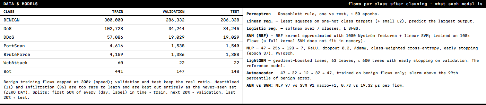

**Learning curves**: score vs amount of training data.

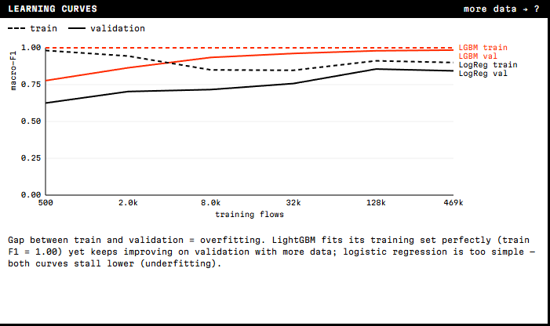

LightGBM keeps getting better with more data. Logistic regression stops improving early (too simple: underfitting).

**Overfitting and remedies**: a big neural network trained on only 660 flows.

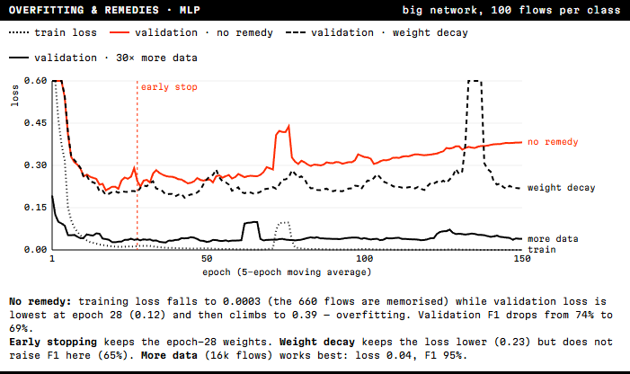

- Training loss goes to almost 0 (it memorised the 660 flows), but validation loss is lowest at epoch 28 and then climbs. That is overfitting.
- **Early stopping** keeps the epoch-28 weights.
- **Weight decay** keeps the loss lower but did not improve accuracy here.
- **More data** (16k flows) fixes it best: validation F1 goes from 69% to 95%.

**Perceptron**: two classes squeezed into 2-D.

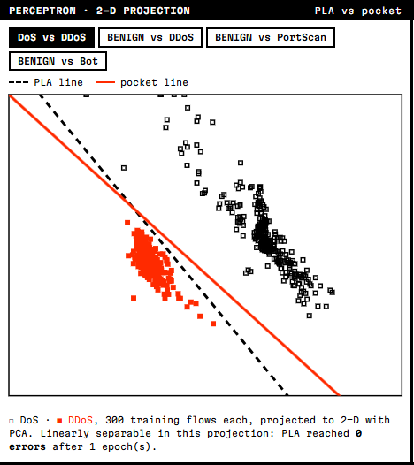

DoS vs DDoS can be split by one straight line, so the perceptron finds it in 1 epoch. Pairs that can't be split by a line (try *BENIGN vs Bot*) never settle; the **pocket** version keeps the best line it has seen.

**Evasion**: how detection drops when attacks are slowed down or padded.

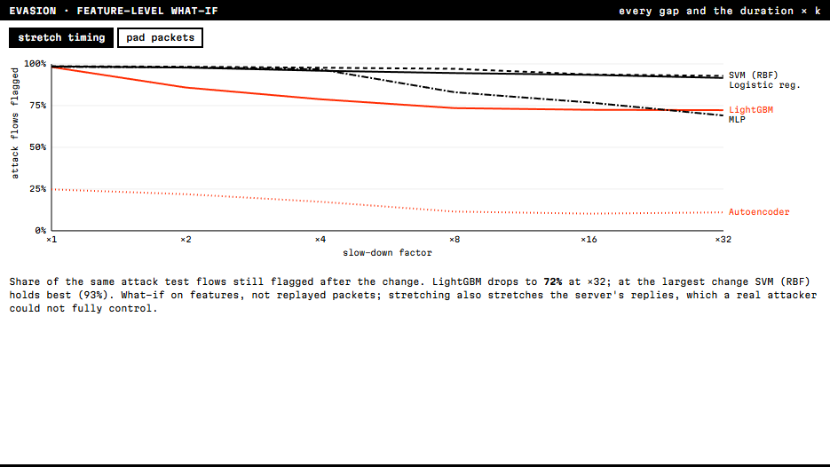

The most accurate model is not the toughest one. Slowed down 8×, LightGBM catches 74% of attacks; the SVM still catches 97%.

**2017 → 2018**: same models on a different network.

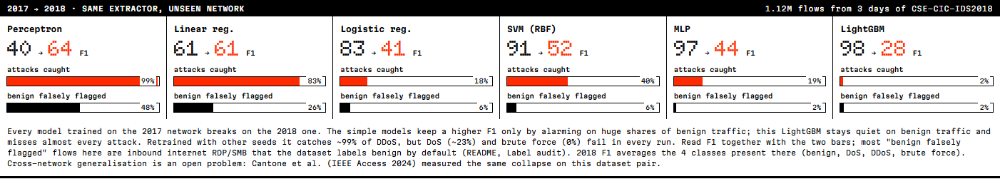

Every model breaks on at least part of the new network. The shipped LightGBM catches only 1.7% of attacks because it misses all DDoS. That part is seed luck: retrained with four other seeds it catches ~99% of DDoS, about 71% of attacks overall. What fails in every run is DoS (~23% caught) and brute force (0%). The perceptron catches 99% but flags 48% of normal traffic, so it is not really working either. Read the "benign falsely flagged" bars with care: 75–98% of LightGBM's 2018 false alarms are inbound internet RDP/SMB traffic that the dataset labels benign by default (README, Label audit). This is the biggest open problem in this field, and the honest headline of the project.

**Honest evaluation**: the checks we did before trusting any number.

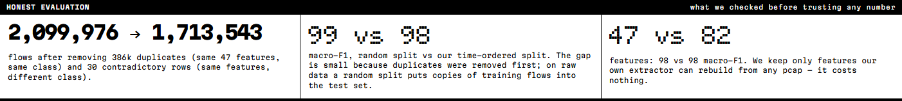

### 04 ZERO-DAY: attacks it has never seen

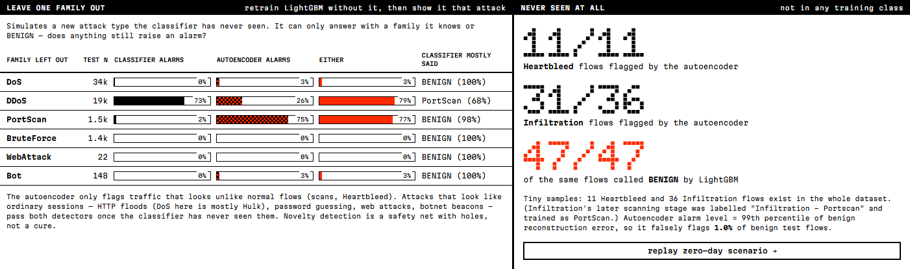

- **Left**: we retrain LightGBM with one family removed, then show it that family. A classifier can only answer with a label it knows, so it mostly says BENIGN. The autoencoder still catches 75% of port scans, but almost none of the DoS, brute-force, web or botnet flows, because those look like normal sessions.
- **Right**: Heartbleed (11/11) and Infiltration (31/36) are flagged by the autoencoder, while LightGBM calls all 47 of them benign.
- Takeaway: novelty detection helps, but it has holes.

### 05 PCAP: try your own capture

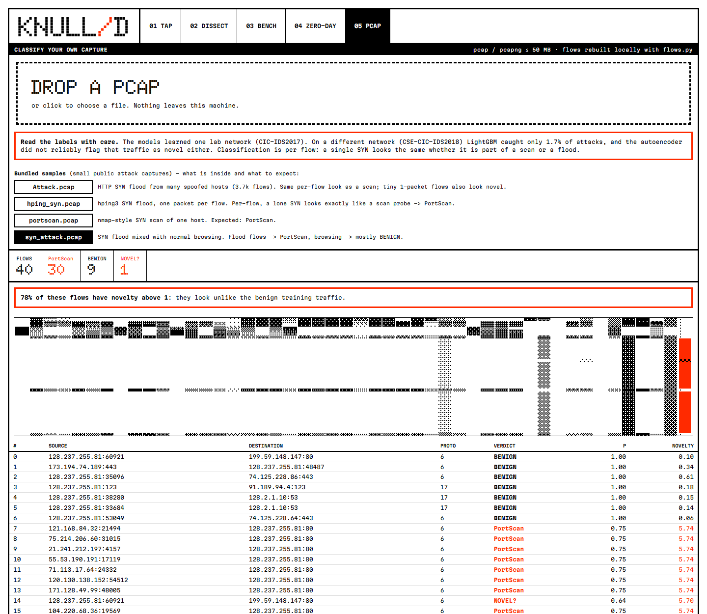

- Drop a `.pcap` / `.pcapng` file, or click a bundled sample. The file is processed on your machine.
- The app rebuilds flows from the packets, computes the 47 features, and runs the models.
- Read the warning: the models learned one lab network, so labels on other networks are a rough guess. A SYN flood often comes out as **PortScan**, because one lone SYN packet looks the same in both.

---

## Main results in five lines

1. On the test week, LightGBM gets 98 macro-F1 with 0.03% false alarms (0.0035% once mislabelled scan probes are corrected); the MLP is close at 97.
2. Simple linear models (perceptron, linear regression) are not enough for this problem.
3. On a different network (2018), every model fails. This is the real limit of the approach.
4. The most accurate model (LightGBM) is also the easiest to fool by slowing an attack down.
5. The autoencoder catches some never-seen attacks (Heartbleed, scans) but misses ones that look like normal traffic.

## Limits to mention

- Judged one flow at a time: no view of what a host does over minutes (that would separate a scan from a flood).
- Rare classes are tiny (22 web-attack flows in the test set), so their scores are noisy.
- `flows.py` follows the dataset's feature rules but was checked with a hand-made test, not against the original tool, because the original raw captures need a registration form.
- Evasion is a feature-level "what if", not a real attack.

## Questions you may get

- **Why LightGBM and not just the neural network?** Trees are very strong on table-like data like this; it is the reference. The MLP is close (97 vs 98) and 12× faster per flow.
- **Why macro-F1 and not accuracy?** 84% of test flows are benign. A model that says "benign" for everything would get 84% accuracy and catch nothing.
- **Why split by time?** A random split puts near-copies of training flows in the test set and inflates scores. Splitting by time tests on later traffic.
- **Why only 47 features when the dataset has 82?** Those are the ones our code can rebuild from any pcap. Using all 82 changes the score by less than 1 point.
- **Why does the 2018 test fail so badly?** Different network, different machines, different background traffic. The models learned what *that* lab looked like, not what attacks look like everywhere.
